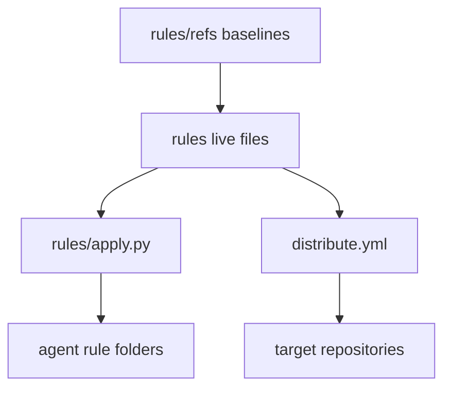

# Clankers

Rules, skills, and workflows for AI agents.

- [rules/](rules/): shared and platform-specific instructions, both ChatGPT fields, and commit rules. See [specification and setup](rules/README.md).
- [skills/](skills/README.md): UI reviews, text compression, and a shared Arena steering/reporting preview. Each skill has `SKILL.md` and supporting files.
- [github/workflows/](github/workflows/README.md): reusable AI GitHub Actions sources, without instruction budgets. The Gemini workflow proposes a version and notes from commit history. A separate approved run creates a tag and draft.
- [automations/](automations/DAILIES.md): recurring prompts, currently combined daily monitoring through ChatGPT scheduled tasks. Each self-contained Markdown prompt runs in one pass and supplies state/evidence rules because runtime state is unreliable.
- [userscripts/](userscripts/README.md): Tampermonkey userscripts for Arena and ChatGPT. Two domain bundles provide saved feature switches. Arena fills the `/agent` composer, opens the `{repo} - Steering` preview, and hides the composer while generating. ChatGPT hides promo and nav elements and clicks Think every second.
- [maintenance/](maintenance/README.md): validation, synchronization, and README measurement tooling, requiring `markdown-it-py` and the npm package `gpt-tokenizer`.
- [rules/refs/](rules/refs/README.md): uncompressed originals and AGENTS.md writing guidelines.
- [skills/refs/](skills/refs/): complete unsquashed source trees for skills with baselines.

`rules/apply.py` copies the global rule files. `apply.bat` runs it on Windows.

## Rules flow

## Instruction budgets

Latest measurements as of 2026-10-22. `maintenance/check.py --update` rebuilds the table and refuses drift. The table covers the arena suite: ARENA.md and the arena-skill clause files, one row each, plus one row for all non-clause arena-skill files. Skill refs stay out.

| File | Measure | Current |
| --- | --- | --- |
| [`gpt-plugins/skills/gpt-display/SKILL.md`](gpt-plugins/skills/gpt-display/SKILL.md) | `o200k_base` | 1,659 `tok` |
| [`gpt-plugins/skills/gpt-github/SKILL.md`](gpt-plugins/skills/gpt-github/SKILL.md) | `o200k_base` | 433 `tok` |
| [`gpt-plugins/skills/gpt-handoff/SKILL.md`](gpt-plugins/skills/gpt-handoff/SKILL.md) | `o200k_base` | 1,301 `tok` |
| [`gpt-plugins/skills/gpt-planning/SKILL.md`](gpt-plugins/skills/gpt-planning/SKILL.md) | `o200k_base` | 359 `tok` |
| [`gpt-plugins/skills/gpt-question/SKILL.md`](gpt-plugins/skills/gpt-question/SKILL.md) | `o200k_base` | 145 `tok` |
| [`gpt-plugins/skills/gpt-quirks/SKILL.md`](gpt-plugins/skills/gpt-quirks/SKILL.md) | `o200k_base` | 134 `tok` |
| [`rules/ARENA.md`](rules/ARENA.md) | `o200k_base` | 4,293 `tok` |
| [`rules/CHATGPT-CUSTOM.txt`](rules/CHATGPT-CUSTOM.txt) | `Unicode chars` | 1,442 `chars` |
| [`rules/CHATGPT-MORE.txt`](rules/CHATGPT-MORE.txt) | `Unicode chars` | 1,369 `chars` |
| [`rules/CLINE.md`](rules/CLINE.md) | `o200k_base` | 335 `tok` |
| [`rules/COMMIT-SPEC.txt`](rules/COMMIT-SPEC.txt) | `o200k_base` | 84 `tok` |
| [`rules/CORE.md`](rules/CORE.md) | `o200k_base` | 1,775 `tok` |
| [`rules/KILO.md`](rules/KILO.md) | `o200k_base` | 76 `tok` |
| [`rules/kilo/code.md`](rules/kilo/code.md) | `o200k_base` | 235 `tok` |
| [`rules/kilo/debug.md`](rules/kilo/debug.md) | `o200k_base` | 284 `tok` |
| [`rules/kilo/plan.md`](rules/kilo/plan.md) | `o200k_base` | 279 `tok` |
| [`skills/amending-violations/SKILL.md`](skills/amending-violations/SKILL.md) | `o200k_base` | 1,607 `tok` |
| [`skills/arena-skill`](skills/arena-skill) | `UTF-8 file size` | 487,090 `B` |
| [`skills/arena-skill/references/REFERENCE.md`](skills/arena-skill/references/REFERENCE.md) | `o200k_base` | 3,915 `tok` |
| [`skills/arena-skill/SKILL.md`](skills/arena-skill/SKILL.md) | `o200k_base` | 4,175 `tok` |
| [`skills/nemo-ui-ux/SKILL.md`](skills/nemo-ui-ux/SKILL.md) | `o200k_base` | 1,505 `tok` |
| [`skills/nemoizer/SKILL.md`](skills/nemoizer/SKILL.md) | `o200k_base` | 954 `tok` |
| [`skills/squash/SKILL.md`](skills/squash/SKILL.md) | `o200k_base` | 1,377 `tok` |
| [`system-prompts/NEMOGPT.md`](system-prompts/NEMOGPT.md) | `o200k_base` | 3,375 `tok` |
| [`system-prompts/wenyan/NEMOGPT.md`](system-prompts/wenyan/NEMOGPT.md) | `o200k_base` | 3,327 `tok` |
| [`userscripts/arena-prompt-fill.txt`](userscripts/arena-prompt-fill.txt) | `o200k_base` | 356 `tok` |

`rules/ARENA.md` and the shipped preview assets and scripts measure by UTF-8 file size, the two ChatGPT fields by Unicode characters, and every other file by `o200k_base` tokens. `maintenance/minify/minify.py` builds the minified files from readable refs, and their recorded sizes are their budgets. Measurements cover complete files, including whitespace and markup.

## Compression

Use the [`squash` skill](skills/squash/SKILL.md) for compression. See [maintenance/README.md](maintenance/README.md) for repository-specific budget and synchronization procedures.
