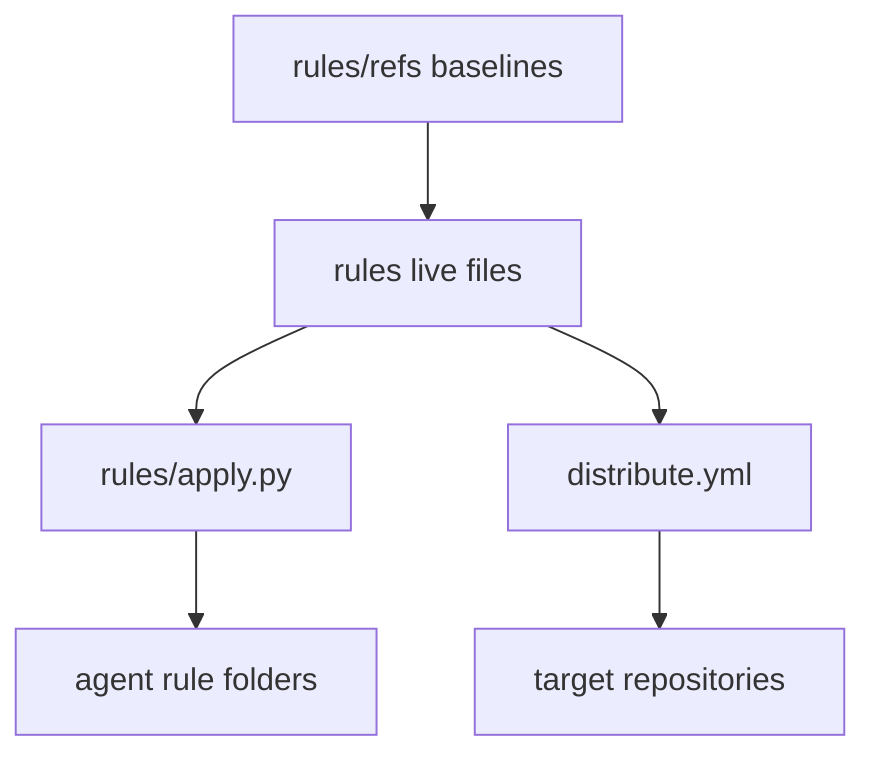

# Clankers

Rules, skills, and workflows for AI agents.

- [rules/](rules/): shared and platform-specific instructions, both ChatGPT fields, and commit rules. See [specification and setup](rules/README.md).
- [skills/](skills/README.md): UI reviews, text compression, and a shared Arena steering/reporting preview. Each skill has `SKILL.md` and supporting files.
- [github/workflows/](docs/workflows/gemini-release/README.md): reusable AI GitHub Actions sources without instruction budgets. The Gemini workflow proposes a version and notes, and an approved run creates the tag and draft.
- [automations/](automations/DAILIES.md): recurring prompts, currently combined daily monitoring through ChatGPT scheduled tasks. Each self-contained Markdown prompt runs in one pass and supplies state/evidence rules because runtime state is unreliable.
- [userscripts/](userscripts/): Tampermonkey userscripts for [Arena](docs/userscripts/arena/README.md) and [ChatGPT](docs/userscripts/chatgpt/README.md) with two domain bundles that provide saved feature switches. Arena fills `/agent`, opens `{repo} - Steering`, and hides the composer while generating, while ChatGPT hides promo/nav elements and clicks Think every second.
- [maintenance/](maintenance/README.md): validation, synchronization, and README measurement tooling, requiring `markdown-it-py` and the npm package `gpt-tokenizer`.
- [rules/refs/](rules/refs/README.md): uncompressed originals and AGENTS.md writing guidelines.
- [skills/refs/](skills/refs/): complete unsquashed source trees for skills with baselines.

`rules/apply.py` copies the global rule files. `apply.bat` runs it on Windows.

## Rules flow

## Instruction budgets

| File | Measure | Current |
| --- | --- | --- |
| [`gpt-plugins/skills/gpt-display/SKILL.md`](gpt-plugins/skills/gpt-display/SKILL.md) | `o200k_base` | 1,596 `tok` |
| [`gpt-plugins/skills/gpt-github/SKILL.md`](gpt-plugins/skills/gpt-github/SKILL.md) | `o200k_base` | 433 `tok` |
| [`gpt-plugins/skills/gpt-handoff/SKILL.md`](gpt-plugins/skills/gpt-handoff/SKILL.md) | `o200k_base` | 1,373 `tok` |
| [`gpt-plugins/skills/gpt-planning/SKILL.md`](gpt-plugins/skills/gpt-planning/SKILL.md) | `o200k_base` | 359 `tok` |
| [`gpt-plugins/skills/gpt-question/SKILL.md`](gpt-plugins/skills/gpt-question/SKILL.md) | `o200k_base` | 157 `tok` |
| [`gpt-plugins/skills/gpt-quirks/SKILL.md`](gpt-plugins/skills/gpt-quirks/SKILL.md) | `o200k_base` | 134 `tok` |
| [`rules/ARENA.md`](rules/ARENA.md) | `o200k_base` | 4,972 `tok` |
| [`rules/CHATGPT-CUSTOM.txt`](rules/CHATGPT-CUSTOM.txt) | `Unicode chars` | 1,498 `chars` |
| [`rules/CHATGPT-MORE.txt`](rules/CHATGPT-MORE.txt) | `Unicode chars` | 1,497 `chars` |
| [`rules/CLINE.md`](rules/CLINE.md) | `o200k_base` | 335 `tok` |
| [`rules/COMMIT-SPEC.txt`](rules/COMMIT-SPEC.txt) | `o200k_base` | 84 `tok` |
| [`rules/CORE.md`](rules/CORE.md) | `o200k_base` | 1,802 `tok` |
| [`rules/KILO.md`](rules/KILO.md) | `o200k_base` | 76 `tok` |
| [`rules/kilo/code.md`](rules/kilo/code.md) | `o200k_base` | 235 `tok` |
| [`rules/kilo/debug.md`](rules/kilo/debug.md) | `o200k_base` | 284 `tok` |
| [`rules/kilo/plan.md`](rules/kilo/plan.md) | `o200k_base` | 279 `tok` |
| [`skills/nemoizer/SKILL.md`](skills/nemoizer/SKILL.md) | `o200k_base` | 1,475 `tok` |
| [`skills/nuu/SKILL.md`](skills/nuu/SKILL.md) | `o200k_base` | 3,730 `tok` |
| [`skills/squash/SKILL.md`](skills/squash/SKILL.md) | `o200k_base` | 1,388 `tok` |
| [`system-prompts/NEMOGPT.md`](system-prompts/NEMOGPT.md) | `o200k_base` | 3,602 `tok` |
| [`system-prompts/wenyan/NEMOGPT.md`](system-prompts/wenyan/NEMOGPT.md) | `o200k_base` | 3,401 `tok` |
| [`userscripts/arena-prompt-fill.txt`](userscripts/arena-prompt-fill.txt) | `o200k_base` | 872 `tok` |

## Compression

Live rule and skill files use [`squash`](skills/squash/SKILL.md) compression, and [maintenance/README.md](maintenance/README.md) covers budget and sync checks.
