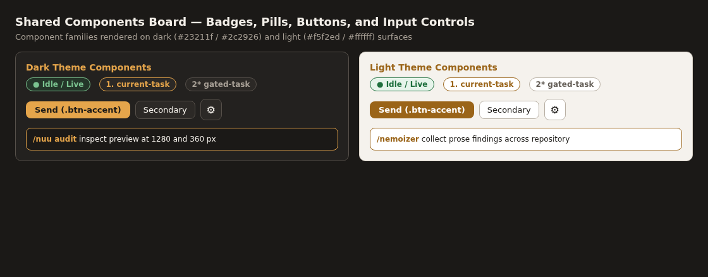

# Shared components visual reference

Status: accepted. Images: captured. Verification: `nuu audit` at `1280` and `360` px.
Design authority: [Design record](../design.md).

## Component family sheet

## Covered families

- Status badges and task pills: `#status-pill`, `.task-pill`, `.log-badge`, and `.field-badge` across active, waiting, and completed states.
- Button families: `.btn-accent` primary actions, secondary toolbar buttons, `.icon-button` `34x34` px symmetric controls, and `#modal-close` exit button.
- Input fields and composer: `#log-search`, `#composer-input` with slash-command highlight overlay, and report radio, checkbox, and custom text fields.

## Shared references

- [Preview workflow](preview.md): overview wireframe, detail wireframe, `1280` and `360` px workflow views, and state board.
- [Style reference](styles.md): composite foundation board (`../images/styles-board.png`) showing the typography ramp, color palette families, spacing scale, elevations, and corner radii.

## Image evidence

| Image | Purpose | Source | License | Date | Verification |
| --- | --- | --- | --- | --- | --- |
| `../images/components-board.png` | Shared component family and state board | `skills/refs/arena-skill` | MIT | 2026-10-24 | `nuu audit` (`1280`, `360`) |
