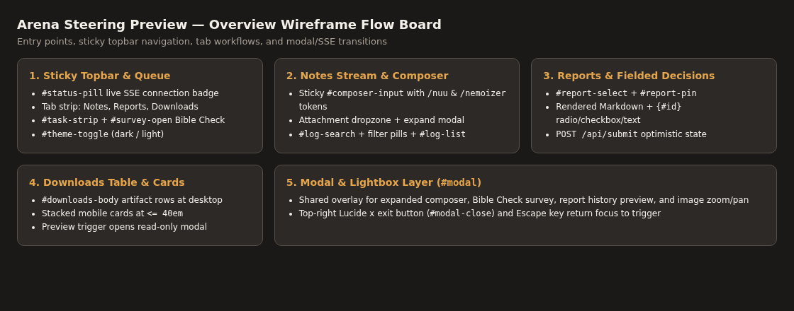
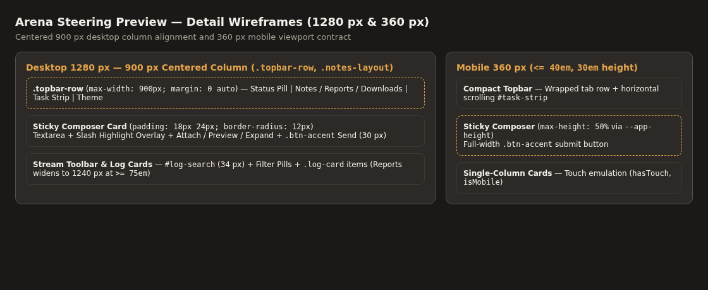
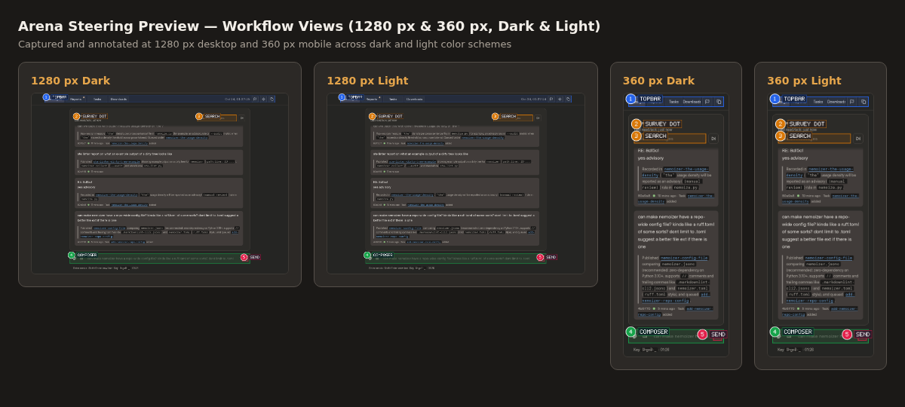
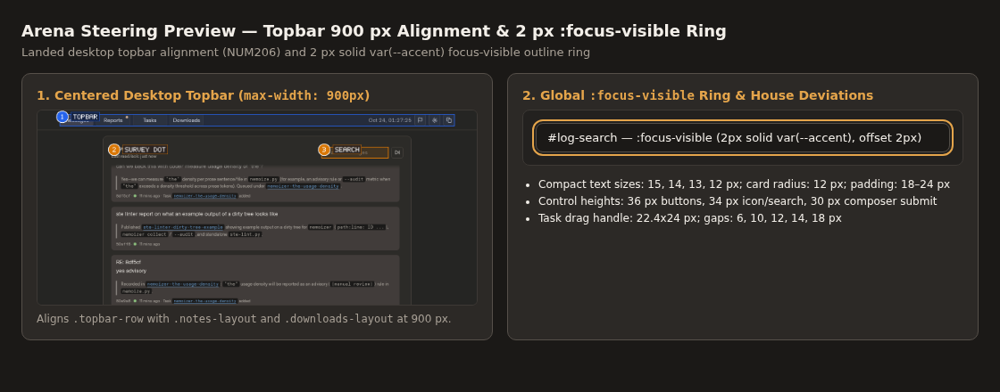
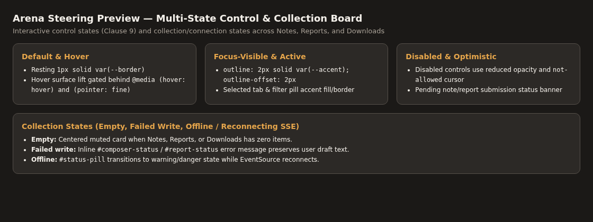

# Preview workflow visual reference

Status: accepted. Images: captured. Verification: `nuu audit` at `1280` and `360` px.
Design authority: [Design record](../design.md).

## Overview wireframe

## Detail wireframes

## Workflow views

## Component states

## Shared references

- [Shared components](components.md): composite component board (`../images/components-board.png`) showing badges, pills, button families, and input states across light and dark backgrounds.
- [Style reference](styles.md): composite foundation board (`../images/styles-board.png`) showing the typography ramp, color palette families, spacing scale, elevations, and corner radii.

## Image evidence

| Image | Purpose | Source | License | Date | Verification |
| --- | --- | --- | --- | --- | --- |
| `../images/preview-overview.png` | Entry points and tab flow wireframe board | `skills/refs/arena-skill` | MIT | 2026-10-24 | `nuu audit` (`1280`, `360`) |
| `../images/preview-detail.png` | Notes, Reports, and Downloads detail wireframe | `skills/refs/arena-skill` | MIT | 2026-10-24 | `nuu audit` (`1280`, `360`) |
| `../images/preview-default.png` | Side-by-side `1280` and `360` px dark and light views | `skills/refs/arena-skill` | MIT | 2026-10-24 | `nuu audit` (`1280`, `360`) |
| `../images/preview-changed.png` | Centered `900` px topbar and `2` px `:focus-visible` ring | `skills/refs/arena-skill` | MIT | 2026-10-24 | `nuu audit` (`1280`, `360`) |
| `../images/preview-states.png` | Control, composer, task queue, and modal states | `skills/refs/arena-skill` | MIT | 2026-10-24 | `nuu audit` (`1280`, `360`) |
