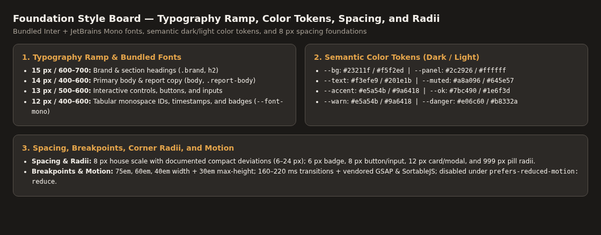

# Style reference

Status: accepted. Images: captured. Verification: `nuu audit` at `1280` and `360` px.
Design authority: [Design record](../design.md).

## Foundation style board

## Covered foundations

- Typography ramp: Inter UI text (`15`, `14`, `13`, `12` px at `400`, `600`, `700`) and JetBrains Mono (`12` px tabular figures).
- Color roles: dark (`#23211f` bg, `#2c2926` panel, `#f3efe9` text, `#e5a54b` accent) and light (`#f5f2ed` bg, `#ffffff` panel, `#201e1b` text, `#9a6418` accent).
- Spacing, elevation, and radii: `8` px house base with documented compact deviations (`6` to `24` px), `1` px structural borders, and `6`, `8`, `12`, and `999` px radii.

## Shared references

- [Preview workflow](preview.md): overview wireframe, detail wireframe, `1280` and `360` px workflow views, and state board.
- [Shared components](components.md): composite component board (`../images/components-board.png`) showing badges, pills, button families, and input states.

## Image evidence

| Image | Purpose | Source | License | Date | Verification |
| --- | --- | --- | --- | --- | --- |
| `../images/styles-board.png` | Typography, color palette, spacing, and radius board | `skills/refs/arena-skill` | MIT | 2026-10-24 | `nuu audit` (`1280`, `360`) |
