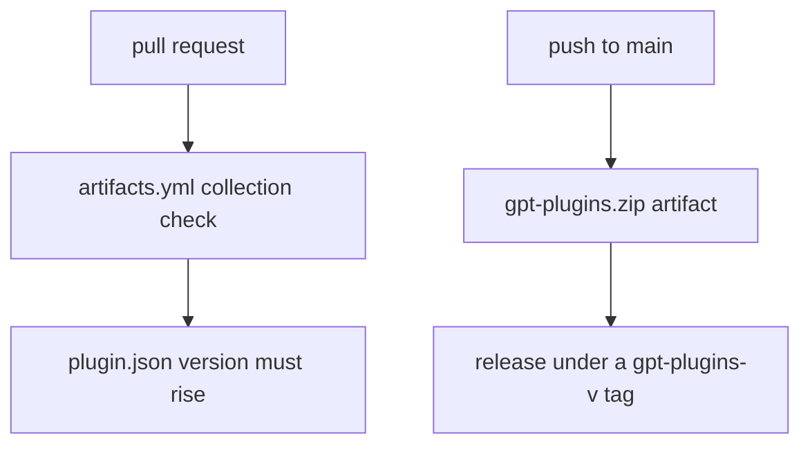

# GPT Plugins

One Agent Plugins 1.0.0 collection and seven single-skill plugins for GPT-specific skills. The manifest `plugin.json` owns the plugin metadata and version.

| Path | Purpose |
| --- | --- |
| `plugin.json` | Manifest. The checker checks it against the canonical schema at agent-plugins.org. |
| `assets/<name>.svg` | Square `64x64` SVG icons for the collection and each single-skill archive, packaged at `assets/icon.svg` and `skills/<name>/assets/icon.svg` with `skills/<name>/agents/openai.yaml`. |
| `skills/<name>/SKILL.md` | Shipped skill copies. The archive carries these. |
| `refs/skills/<name>/SKILL.md` | Readable sources. Keep these full. Compress shipped copies without losing rules. |
| `skills/<name>/references/` | Per-type detail files. A reader loads only the file its answer needs. The shipped copy may be squashed, but it preserves every fenced code block byte for byte. |
| `README.md` | This file. It never ships. |

## Skills

| Skill | Purpose |
| --- | --- |
| [gpt-quirks](../../gpt-plugins/skills/gpt-quirks/SKILL.md) | Apply verified GPT and connected tool quirks when they are relevant |
| [gpt-handoff](../../gpt-plugins/skills/gpt-handoff/SKILL.md) | Audit agent work and human-facing docs. Use Ponytail for code and docs audits. Own the final format or draft a handoff. |
| [gpt-planning](../../gpt-plugins/skills/gpt-planning/SKILL.md) | Check requirements and completion before each plan, handoff, execution, and final report. |
| [gpt-github](../../gpt-plugins/skills/gpt-github/SKILL.md) | Apply the owner's git and GitHub rules to every git or GitHub action. |
| [gpt-display](../../gpt-plugins/skills/gpt-display/SKILL.md) | Choose and author supported response representations: DIL interfaces, source bindings, charts, maps, host actions, and Mermaid diagrams. |
| [gpt-question](../../gpt-plugins/skills/gpt-question/SKILL.md) | Ask for needed user input with supported interactive forms and visible custom answers. |
| [nemoizer](../../skills/nemoizer/SKILL.md) | Write and edit prose, comments, and documentation with ASD-STE100 and Humanizer rules, and audit code comments and tests. |

## Edit a skill

Skill sources live under `refs/skills/`. Compress shipped copies manually, preserving every rule, condition, exception, command, and heading. Review each clause against its source. Increase the plugin version for every update.

See [maintenance/README.md](../../maintenance/README.md) for synchronization and validation.

## Package

`.github/workflows/artifacts.yml` checks the collection on pull requests. A pull request that changes shipped plugin files must raise the `plugin.json` version above the base branch.

Pushes to `main` write the eight ZIPs below as direct Actions artifacts. On-demand runs package only from `main`.

The `release-gpt-plugins` job in `.github/workflows/artifacts.yml` downloads the package job's checked ZIPs and publishes those unchanged bytes. The GitHub Release uses the versioned tag `gpt-plugins-v<version>`, taken from `plugin.json`.

A tag that exists keeps its release and gets the fresh asset, so the download URL stays stable. The collection archive carries `plugin.json` and `skills/` only, so `refs/` and this README stay out of it. The workflow fails on a missing or invalid plugin file.

## Release assets

Every single-skill ZIP has a unique manifest name and the collection version. It carries one complete skill, all its references, and a generated README with dependency notes. The collection ZIP keeps all seven skills.

| Asset | Dependencies outside that ZIP |
| --- | --- |
| `gpt-plugins.zip` | Ponytail for handoff audits, plus host tools and interface features |
| `gpt-quirks.zip` | Host file references and tools |
| `gpt-handoff.zip` | `gpt-planning` and Ponytail |
| `gpt-planning.zip` | `gpt-handoff` |
| `gpt-github.zip` | Host GitHub tools |
| `gpt-display.zip` | Host rendering and file features |
| `gpt-question.zip` | Host interactive form features |
| `nemoizer.zip` | Python 3 runtime for `scripts/` linters |

The single-skill ZIPs do not bundle the other skills or install host tools. Archive checks do not prove ChatGPT import support. No ChatGPT import test ran for this change.

The checker builds and checks all eight ZIPs with `--package-dir`. It checks downloaded ZIPs with `--archives-dir`. The existing `--archive` flag checks the collection, or one single-skill ZIP when paired with `--skill`.
