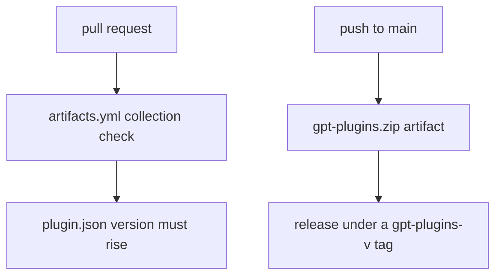

# GPT Plugins

One Agent Plugins 1.0.0 collection and seven single-skill plugins for GPT-specific skills. The manifest `plugin.json` owns the plugin metadata and version.

| Path | Purpose |
| --- | --- |
| `plugin.json` | Manifest. The checker checks it against the canonical schema at agent-plugins.org. |
| `assets/<name>.svg` | Square `64x64` SVG icons for the collection and each single-skill archive, packaged at `assets/icon.svg` and `skills/<name>/assets/icon.svg` with `skills/<name>/agents/openai.yaml`. |
| `skills/<name>/SKILL.md` | Shipped skill copies. The archive carries these. |
| `refs/skills/<name>/SKILL.md` | Uncompressed source skills kept in full wording for human review and editing. |
| `skills/<name>/references/` | Per-type detail files loaded on demand. Shipped copies may be compressed while keeping fenced code blocks byte-identical. |
| `README.md` | Human overview (`docs/gpt-plugins/README.md`), omitted from packaged ZIPs. |

## Skills

| Skill | Purpose |
| --- | --- |
| [gpt-quirks](../../gpt-plugins/skills/gpt-quirks/SKILL.md) | Verified GPT and connected-tool quirks and workarounds. |
| [gpt-handoff](../../gpt-plugins/skills/gpt-handoff/SKILL.md) | Code and documentation audits (including Ponytail findings) and cross-session handoff drafts. |
| [gpt-planning](../../gpt-plugins/skills/gpt-planning/SKILL.md) | Requirement tracking and completion checks across plans, handoffs, execution, and final reports. |
| [gpt-github](../../gpt-plugins/skills/gpt-github/SKILL.md) | Repo Git and GitHub conventions for branch, commit, and PR operations. |
| [gpt-display](../../gpt-plugins/skills/gpt-display/SKILL.md) | Response format selection across DIL interfaces, source bindings, charts, maps, host actions, and Mermaid diagrams. |
| [gpt-question](../../gpt-plugins/skills/gpt-question/SKILL.md) | Interactive decision forms with preset choices and visible custom answers. |
| [nemoizer](../../skills/nemoizer/SKILL.md) | Plain-word prose and comment editing plus lexical and test-assertion linting. |

## Edit a skill

Maintainers edit uncompressed sources under `refs/skills/` and compress shipped copies under `skills/` while keeping every rule, condition, exception, command, and heading. Every shipped plugin change increments the version in `plugin.json`.

See [maintenance/README.md](../../maintenance/README.md) for sync and validation gates.

## Package

`.github/workflows/artifacts.yml` checks the collection on pull requests. A pull request that changes shipped plugin files must raise the `plugin.json` version above the base branch.

Pushes to `main` write the eight ZIPs below as direct Actions artifacts. On-demand runs package only from `main`.

The `release-gpt-plugins` job in `.github/workflows/artifacts.yml` downloads the package job's checked ZIPs and publishes those unchanged bytes. The GitHub Release uses the versioned tag `gpt-plugins-v<version>`, taken from `plugin.json`.

A tag that exists keeps its release and gets the fresh asset, so the download URL stays stable. The collection archive carries `plugin.json` and `skills/` only, so `refs/` and this README stay out of it. The workflow fails on a missing or invalid plugin file.

## Release assets

Every single-skill ZIP has a unique manifest name and the collection version. It carries one complete skill, all its references, and a generated README with dependency notes. The collection ZIP keeps all seven skills.

| Asset | Dependencies outside that ZIP |
| --- | --- |
| `gpt-plugins.zip` | Ponytail for handoff audits, plus host tools and interface features |
| `gpt-quirks.zip` | Host file references and tools |
| `gpt-handoff.zip` | `gpt-planning` and Ponytail |
| `gpt-planning.zip` | `gpt-handoff` |
| `gpt-github.zip` | Host GitHub tools |
| `gpt-display.zip` | Host rendering and file features |
| `gpt-question.zip` | Host interactive form features |
| `nemoizer.zip` | Python 3 runtime for `scripts/` linters |

The single-skill ZIPs do not bundle the other skills or install host tools. Archive checks do not prove ChatGPT import support.

The checker builds and checks all eight ZIPs with `--package-dir`. It checks downloaded ZIPs with `--archives-dir`. The existing `--archive` flag checks the collection, or one single-skill ZIP when paired with `--skill`.
