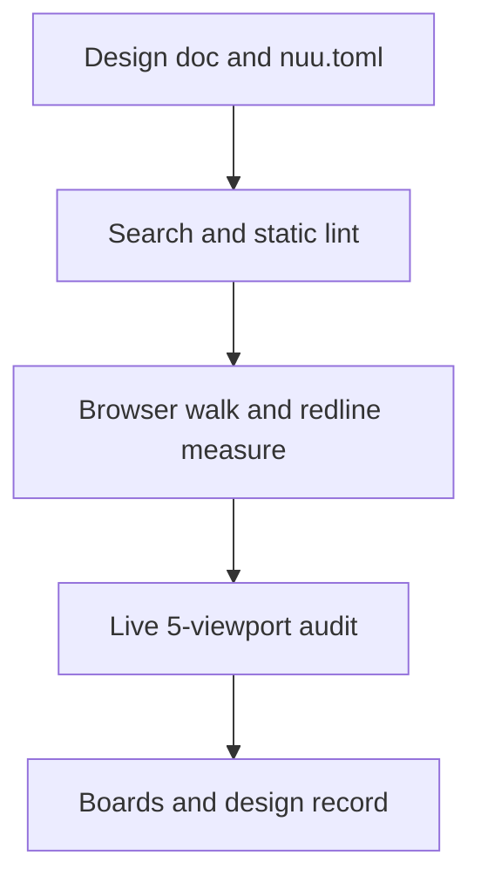

# Nemo UI/UX

The abbreviation is **nuu** (say **new**).

Build, refine, and review web interfaces. Tools cover catalogs, design records, asset checks, static lint, live measurements, annotations, design boards, and browser walks. Existing product systems take precedence over the optional house profile.

## Setup

Copy `skills/nuu` into a supported skill directory, and see [Skills](../../skills/README.md) for discovery paths. [SKILL.md](../../skills/nuu/SKILL.md) is the agent entry point. Runtime tools need Python 3.11+ and `playwright>=1.49`, plus a local Chromium binary (`$CHROMIUM_BIN` or `PATH`) for live browser commands.

The project supplies its page, running server, and browser binary. Tools never download packages or Playwright-managed browsers automatically.

## Working flow

1. Project context starts from `[paths].doc` in `nuu.toml` (`docs/design.md` default) or [the v2 template](../../skills/nuu/references/design-document.md).
2. Styling follows `[paths].stylesheet`, or falls back to the house [sheet](../../skills/nuu/references/style.css) and [examples](../../skills/nuu/references/examples.md).
3. Live checks inspect the five house viewports (`1920x957`, `1080x2437`, `958x958`, `855x325`, and `411x799`) across `68em`, `60em`, `30em`, and `24em`.
4. [Measurement tools](../../skills/nuu/references/measure.md), [walks](../../skills/nuu/references/walk.md), and [boards](../../skills/nuu/references/annotate.md) produce Markdown tables and dark-mode PNG evidence.
5. Settled design decisions, approved deviations, and board links stay recorded in the project's `docs/design.md`.

## Nine CLI commands

From the repository root in Windows cmd:

```cmd
set UI=skills\nuu\scripts\nuu.py
python %UI% doctor -c path\to\nuu.toml
python %UI% search "dashboard accessibility" -d ux-guidelines
python %UI% lint -c path\to\nuu.toml
python %UI% collect -c path\to\nuu.toml
python %UI% measure -c path\to\nuu.toml -u http://127.0.0.1:8000 -s ".card" --to ".button" -o nuu-artifacts\measure.png
python %UI% annotate -c path\to\nuu.toml -u http://127.0.0.1:8000 -b ".button,amber" -C ".dialog,16" -o nuu-artifacts\annotated.png
python %UI% walk -c path\to\nuu.toml path\to\walk.py -o nuu-artifacts -g nuu-artifacts\flow.gif
python %UI% board -c path\to\nuu.toml -s path\to\boards.toml -o docs\design-visuals
python %UI% audit -c path\to\nuu.toml -u http://127.0.0.1:8000 -o nuu-artifacts\audit.md
```



[CLI reference](../../skills/nuu/references/nuu.md) documents all nine subcommands, composite flags, exit codes (`0`..`3`), and `49` conformance rules. Every command reads TOML configuration and emits Markdown or PNG/GIF/WebM outputs (`0` JSON inputs or outputs). Search reads licensed local CSV catalogs with SHA-256 verification.

Read-only checks leave product files untouched. Asset downloads need `-f <url> -o <dest> -A`. Existing `--input` screenshots are never overwritten.

## Limits

Static checks inspect HTML, CSS, SVG, and source markers, while script-rendered DOM states need `nuu audit -u` or `nuu walk`. Passing automated rules does not replace human or agent visual judgment on Clauses 20 to 32.

This README is human documentation and stays outside the installed skill payload. The source credits follow.

## Sources

### Repositories

| Source | Commit | License |
| --- | --- | --- |
| [UI/UX Pro Max](https://github.com/nextlevelbuilder/ui-ux-pro-max-skill/tree/56ea9cf174ed86786187daa9de0e6247cb0747e4) | `56ea9cf` | MIT |
| [Anthropic frontend-design](https://github.com/anthropics/skills/tree/dbd4588f9e1033efb41dad4bef2f7947c8993d44/skills/frontend-design) | `dbd4588` | Apache 2.0 |
| [Taste skill](https://github.com/Leonxlnx/taste-skill/tree/6010f91a9935f1c167dfc500fb1a475681892e6b) | `6010f91` | MIT |
| [Vercel Web Interface Guidelines](https://github.com/vercel-labs/web-interface-guidelines/tree/434b7f91364665f2f733b310ec54809bf8f37937) | `434b7f9` | MIT |
| [Impeccable](https://github.com/pbakaus/impeccable/tree/dad8dbb3aac21ad1fa236c110315ef4abece23e8) | `dad8dbb` | Apache 2.0 |

### Websites — fetched 2026-10-21

- [Jakob Nielsen: 10 Usability Heuristics](https://www.nngroup.com/articles/ten-usability-heuristics/)
- [NN/g: Good Visual Design, Explained](https://www.nngroup.com/articles/good-visual-design/)
- [GOV.UK: Design Manual](https://www.gov.uk/service-manual/design)
- [GOV.UK: Using, adapting and creating patterns](https://www.gov.uk/service-manual/design/using-adapting-and-creating-patterns)
- [W3C: WCAG 2.2 Quick Reference](https://www.w3.org/WAI/WCAG22/quickref/)
- [Atlassian Design System](https://atlassian.design/)
- [Atlassian: Design tokens](https://atlassian.design/foundations/tokens)
- [NN/g: Usability Testing 101](https://www.nngroup.com/articles/usability-testing-101/)
- [Pencil & Paper: UX Design Documentation Guide](https://www.pencilandpaper.io/articles/ux-design-documentation-guide)
- [Figma: Guide to Developer Handoff](https://www.figma.com/best-practices/guide-to-developer-handoff/)
- [Figma: Components, Styles, and Shared Libraries](https://www.figma.com/best-practices/components-styles-and-shared-libraries/)

### Credits

- `nuu` visual-reference structure and composite image-board examples: [UI Prep, The Best Way to Document UX/UI Design](https://www.uiprep.com/blog/the-best-way-to-document-ux-ui-design).
- `nuu` catalog data (`../../skills/nuu/data/vendor/ui-ux-pro-max/`): adapted under the MIT License (`../../skills/nuu/data/vendor/ui-ux-pro-max/LICENSE.txt`).
