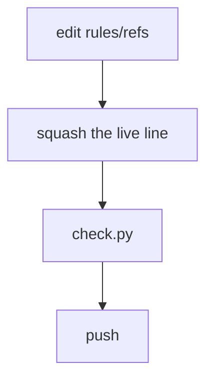

# Maintenance

## Rule maintenance

1. Rule changes land in `rules/refs/` first, and maintainers compress only the new or changed line into the live counterpart.
2. `rules/ARENA.md` optimizes `o200k_base` tokens and matches `rules/CORE.md` in meaning except for push, PR, and merge rules (see Arena file).
3. `rules/KILO.md`, and `rules/kilo/` hold platform-specific rules, and Kilo mode overrides stay outside markdownlint (`MD001`, `MD041`).
4. Rule files keep filename headings, while `rules/CHATGPT-CUSTOM.txt` and `rules/CHATGPT-MORE.txt` extract plain-text lines from `rules/refs/CHATGPT.txt` within 1,500 Unicode characters each.
5. Deployed rule files reserve `MUST` and `NEVER` for hard rules and bold at most two clauses per file (see Emphasis).
6. Skills specialize defaults without weakening explicit user requirements, project conventions, or acceptance criteria.
7. Skills load supporting files on demand from valid relative paths while keeping core operating instructions in `SKILL.md`.
8. Every skill conforms to the Agent Skills specification and records upstream provenance when adapted (see Skill rules).
9. Repo tooling stays minimal, without extra CI workflows, dependency manifests, or test frameworks unless needed.
10. `rules/refs/` holds full wording and `rules/` holds compressed live files. After a deletion, maintainers keep whichever budget is lower.

### Arena file

Arena sessions use `arena-steering` for the Messages, Reports, and Tasks preview while gitignoring session state and published reports. The project retired earlier ntfy and committed-report workflows.

`rules/ARENA.md` compresses wording rather than meaning, preserving negations, conditions, commands, numbers, and caveats. Unlike `rules/CORE.md`, which forbids unrequested pushes and PRs without a merge clause, `rules/ARENA.md` requires pushing, keeping a PR open, and never merging a PR.

`rules/ARENA.md` duplicates core rules intentionally because Arena does not load `AGENTS.md` or `ARENA.md` automatically. `.github/workflows/distribute.yml` copies `ARENA.md` into target repos.

Session activation uses the Arena prompt-fill template in [`userscripts/arena-prompt-fill.txt`](../userscripts/arena-prompt-fill.txt) or manual startup text. That prompt directs the agent to read `AGENTS.md`, `ARENA.md`, and `.agents/skills/arena-steering/SKILL.md` before work.

Root `ARENA.md` is a byte-identical copy of `rules/ARENA.md`, enforced by `maintenance/check.py` and distributed by `.github/workflows/distribute.yml`.

### Emphasis

A deployed rule file keeps two bold clauses at most, so the emphasis keeps its meaning. The cap covers the deployed rule files and their refs baselines. It does not cover this specification, the skills, or the workflows.

| File | Bold clauses |
| --- | --- |
| `CORE.md` | the honesty rule |
| `ARENA.md` | the planned final commit list, the `-f body=@path` ban |
| root `AGENTS.md` | the two markdownlint settings |

`MUST` and `NEVER` stay on the irreversible, the dangerous, and the honesty rules. Every other rule reads positively, because a negated rule that guards nothing costs emphasis (see [refs/GUIDELINES.md](../rules/refs/GUIDELINES.md) section 4.7).

Adding a third bold clause requires unbolding an existing one, reserving bold text for rules that see repeated violations.

### Persona rules

Four deliberate voice rules describe no observable behavior: `Concise, direct, practical, accurate`, `Write clear, readable code`, `Never lazy about understanding`, and `Criticize all`. [refs/GUIDELINES.md](../rules/refs/GUIDELINES.md) 2.3 says not to fight persona on style, and 4.8 requires marking deliberate deviations. These stay at about 60 `tok` in core and 400 `B` in ARENA.md as documented exceptions rather than untestable-rule defects.

The `ARENA.md` constitution has 15 rule lines in both live and refs, within the 5-15 range of [refs/GUIDELINES.md](../rules/refs/GUIDELINES.md) 3.1.

### Skill rules

Testing rules in `rules/` govern downstream projects that adopt those rules rather than adding test frameworks to this repo.

The frontmatter of a skill uses only the specified fields, with `name` matching its directory. A skill that comes from another source records `metadata.upstream`, and the maintainer refreshes it from that source with the local `Precedence` section applied again. See [skills/README.md](../skills/README.md#format).

### Baselines

`rules/refs/` keeps uncompressed baselines so readers do not need git history to inspect original wording. Maintainers edit `rules/refs/` first in full sentences, then compress only new or changed lines into `rules/`. On a removal, maintainers test one squash pass and keep the lower count.

Verbatim baselines would exceed live budgets. Refs preserve originals, identical to live where no compression applied. The adjacent `GUIDELINES.md` is the writing/audit reference, not a baseline, with no live counterpart.

### Formatting

Markdown linting covers repository Markdown and `README.md` files selected by [`.markdownlint-cli2.jsonc`](../.markdownlint-cli2.jsonc). It excludes `AGENTS.md`, `ARENA.md`, non-README rule and skill files, system prompts, archived notes, and `.agents/`. The required blank first line and `###` heading of a Kilo mode override fail MD001 and MD041.

Soft-wrap prose: one line per paragraph, list item and table row. Keep third-party license wrapping.

Rule files keep one rule per line, per [refs/GUIDELINES.md](../rules/refs/GUIDELINES.md) section 4.1. A line can carry the parameters, the enumeration, or the exact command of one rule. It does not carry two rules.

| Surface | Shape |
| --- | --- |
| Markdown rule files | bullets, and a `When in doubt` closer |
| core and `ARENA.md` | a `Use` opener and a constitution |
| `KILO.md` | no opener, and they inherit the core constitution instead of copying it |
| `KILO.md` | no closer, because the core settles the doubts it would restate |
| ChatGPT files | one plain line per rule, free of headings and bullets, per item 4 |
| `COMMIT-SPEC.txt` | its set format, per its single-purpose scope |
| `rules/refs/kilo/` and `rules/kilo/` | a blank line, then `### Native <mode> Agent Overrides`, then the conflict clause |

Kilo wraps the mode overrides as a mode reminder rather than loading them as a full rules file.

[.markdownlint-cli2.jsonc](../.markdownlint-cli2.jsonc) keeps the file selection, the exclusions, and the rule settings together. It keeps the markdownlint defaults, enables **MD060** for table-column consistency, and disables **MD013** so there is no line-length constraint. MD060 uses its default `any` style, and MD007 uses its default two-space list indent, so neither needs a pin.

Run `markdownlint-cli2` from the repository root with no extra globs so local runs match CI.

Core defines Python style (Ruff E4, E7, E9, F), with no managed Ruff dependency. `maintenance/check.py` checks both ChatGPT fields against 1,500 Unicode characters each, including newlines.

## Check



```bash
python3 maintenance/check.py
```

The checker reports every problem it finds in:

- Skill discovery metadata, required `SKILL.md` files, and the Agent Skills naming and frontmatter limits.
- Internal links, README skill coverage, and recorded measurements.
- Both ChatGPT custom-instruction character limits.
- A license declaration on every skill that records `metadata.upstream`, and the `LICENSE.txt` file that the declaration points at.
- Refs/live rule parity: identical section headings in the same order, and each live section holding no more rule lines than its refs baseline.
- The byte identity of the root `ARENA.md` copy and `rules/ARENA.md`.
- Tracked Git paths whose names differ only by letter case.

## Prose lint

```bash
python3 skills/nemoizer/scripts/nemoize.py .
```

`maintenance/check.py` runs the same root `nemoize.py` command, configured by `nemoizer.toml`. The scan covers `docs/`, selected `README.md` files, and first-party code comments, docstrings, and visible HTML text.

Vendored, minified, and archived files stay excluded in `nemoizer.toml`. Ordinary code-comment blocks cap at two lines, and `docs/**/CHANGELOG.md` bullets cap at 3 sentences.

## Update README measurements

```bash
python3 maintenance/check.py --update
```

`check.py` needs `pyyaml` from pip to read skill frontmatter and `gpt-tokenizer` from npm to measure `o200k_base` tokens. Everything else uses the Python standard library.

```bash
python3 -m pip install -r requirements.txt
npm ci
```

`--update` finds each clause file by the `BUDGET_GLOBS` patterns and rebuilds the budget table before checking, so added and retired files need no hand-edited row. Every file measures `o200k_base` tokens except the two ChatGPT fields, which count Unicode characters (`MEASURE_OVERRIDES`). Test it with `python3 -m pytest tests/maintenance/test_check.py`.

## PR checks

The PR-check watcher waits at most 30 seconds for a first visible check on the pinned head. An empty window fails as not started. It then follows the latest checks until every visible one is terminal. API reads time out after five seconds, and API time reduces polling pauses.

A terminal rollup counts only after the head has stood for 30 seconds. A late-registering check still joins the verdict. A moved head restarts both phases. A GitHub read failure fails as unavailable.

It reads all context pages and selects the latest run for each check and workflow, or status context. Each new failure writes a progress line beside the run record, and later gate calls print one per call while the watch stays live. Success is best effort: later checks can still appear.

## Pre-command hook

`skills/arena-steering/scripts/install.sh` registers a Bash `DEBUG` trap that passes each shell command to `steer pre` ([`pre.py`](../skills/arena-steering/scripts/arena_steering/pre.py)). The ordered `PIPELINE` checks guard PR state changes, pending-inbox thresholds, partial shell reads of bible files, and detached routing for long-running commands. See [docs/arena-steering/README.md](../docs/arena-steering/README.md#pre-command-pipeline) for the full check order and exit codes.

## Plugin collection

`gpt-plugins/` is one Agent Plugins collection. It holds `plugin.json` and the shipped skills under `skills/`. The readable skill sources live under `refs/skills/`, and the shipped copies use manually compressed wording with the same meaning and headings. Structural checks validate schema, names, and archive layout, while clause-level parity relies on human review against `refs/skills/`.

```bash
python3 -m pip install -r requirements.txt
python3 maintenance/gpt_plugins/gate_gpt_plugins.py            # report drift, write nothing
```

The checker checks `plugin.json` against the canonical schema at `https://agent-plugins.org/schemas/1.0.0/plugin.schema.json`, which it downloads on every run. Pass `--schema <path>` to check against a local copy offline. It also checks the plugin name, shipped skill names, the Agent Skills frontmatter limits, and the collection tree. `docs/gpt-plugins/README.md` documents the collection and never ships.

`--archive <zip>` compares a packaged archive with the collection. The archive must carry `plugin.json` and `skills/` only, with byte-identical content, so `refs/` never ships. On pull requests, `.github/workflows/artifacts.yml` runs the collection check and requires a higher `plugin.json` version when shipped files change. On `main`, it packages and publishes `gpt-plugins.zip`.

The shipped `SKILL.md` files join the budget table in the root `README.md`. `plugin.json` does not, because it is metadata and not instruction text.

## Token measurement

`check.py` measures `o200k_base` tokens through the npm package `gpt-tokenizer`. The package ships its BPE ranks, so the measurement runs offline after `npm ci` installs the pinned dependencies. No encoding host and no cache seeding play a part.
