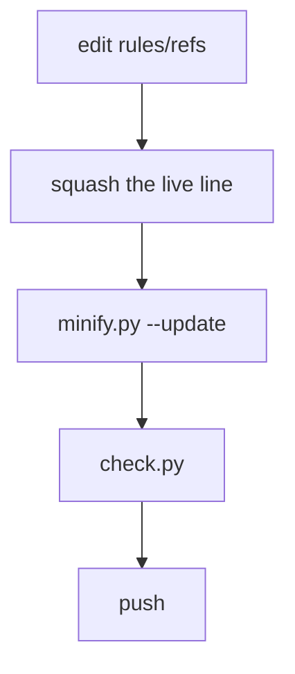

# Maintenance

## Rule maintenance

1. Amend the appropriate file in `rules/refs/` first. Then mirror the amendment into the live file and compress only the new or affected line.
2. Optimize `rules/ARENA.md` for UTF-8 file size. Match the core in meaning, except for push and PR handling (see Arena file).
3. Keep `rules/CLINE.md` and `rules/KILO.md` platform-specific: command discipline, tool names, timeouts. Check every version-specific claim. The Kilo mode overrides pair `rules/refs/kilo/` with the live `rules/kilo/`. The maintainer compresses and budgets each live file, and both sides stay out of the lint because their required shape fails MD001 and MD041.
4. Keep the filename headings of the rule files. Keep `rules/CHATGPT-CUSTOM.txt` and `rules/CHATGPT-MORE.txt`, named for the fields they go into. ChatGPT's Personalization gives `Custom Instructions` and `More about you`, each with a 1,500 Unicode character ceiling. Keep both files plain text with inline labels, never Markdown headings or bullets, within budget, and aligned with the core where it fits. Both fields extract their clauses from one merged baseline, `rules/refs/CHATGPT.txt`. The split places work rules in `Custom Instructions`, and it places response rules plus overflow work rules in `More about you`. ChatGPT keeps nickname and occupation as structured profile fields rather than rule space, and this repository does not version them.
5. Ration the emphasis: a hard rule uses `MUST` or `NEVER`, and a file bolds two clauses at most (see Emphasis).
6. A skill specializes a default. It NEVER weakens an explicit requirement, a convention, or an acceptance criterion.
7. Keep the skill resources on demand, and keep their relative links valid. Do not move essential instructions out of `SKILL.md`.
8. Keep every skill conformant to the Agent Skills specification, with recorded provenance (see Skill rules).
9. Keep this repository light: no further CI workflow, dependency manifest or test scaffolding unless the owner asks for one. The pinned minifier manifest the preview build uses is the one exception, on the owner's approved answers. Review a change directly, and never claim a check that did not run.
10. Keep full wording in `rules/refs/` and compressed wording in the live files. On a removal, attempt one squash and keep the lower budget. Full wording stays in refs, and the compressed form stays in `rules/` (see Baselines).

### Arena file

Arena uses the `arena-skill` skill for one Notes / Reports preview. Keep reports and session state ignored and uncommitted. The steering migration reference records former ntfy and local-report-commit workflows, neither an automatic fallback. Preview permanence is not guaranteed.

Compress wording and sections, not meaning. Keep every negation, condition, command, number, and caveat. Match the generic core in meaning, not byte for byte, except for push, PR, and merge authorization.

ARENA.md always pushes and keeps a PR open so work survives a limit. Core forbids pushes and PRs unless asked but has no merge clause. NEVER merge a pull request as an Arena agent, even with authorization or instructions to merge. Do not repeat Arena-managed branch mechanics beyond that.

The duplication of the core is deliberate. In Arena, no platform loads ARENA.md or AGENTS.md on its own. So the file stands alone instead of overlaying the core, and it takes effect only after the agent has it in context. Exploration does not gate activation.

Activation is a human step, and delivery is not activation. `.github/workflows/distribute.yml` only puts the file in each target repository, and `rules/apply.py` deliberately does not install it.

Put this exact line in the first message of the session. Put it in the custom-instructions field of the platform: `Read and apply AGENTS.md and ARENA.md at the repository root before your first edit. confirm in one line.` The preamble of the file then requires an Arena agent that reads it to apply it. It also requires an agent that did not receive it in context to open it before the first edit.

After each amendment, run `cp rules/ARENA.md ARENA.md`. `.github/workflows/distribute.yml` pushes the root copy to target repositories. `maintenance/check.py` rejects missing or different root copies.

### Emphasis

A deployed rule file keeps two bold clauses at most, so the emphasis keeps its meaning. The cap covers the deployed rule files and their refs baselines. It does not cover this specification, the skills, or the workflows.

| File | Bold clauses |
| --- | --- |
| `CORE.md` | the honesty rule |
| `ARENA.md` | the planned final commit list, the `-f body=@path` ban |
| `CLINE.md` | `STOP`, the self-assignment ban |
| root `AGENTS.md` | the two markdownlint settings |

`MUST` and `NEVER` stay on the irreversible, the dangerous, and the honesty rules. Every other rule reads positively, because a negated rule that guards nothing costs emphasis (see [refs/GUIDELINES.md](../rules/refs/GUIDELINES.md) section 4.7).

A third bold clause in a rule file means one other clause becomes plain. Do not emphasize a rule merely because it is important. Emphasize the rules that get violated.

### Persona rules

Four deliberate voice rules describe no observable behavior: `Concise, direct, practical, accurate`, `Write clear, readable code`, `Never lazy about understanding`, and `Criticize all`. [refs/GUIDELINES.md](../rules/refs/GUIDELINES.md) 2.3 says not to fight persona on style, and 4.8 requires marking deliberate deviations. These stay at about 60 `tok` in core and 400 `B` in ARENA.md. Audit them as marked exceptions, not untestable-rule violations.

The `ARENA.md` constitution has 15 rule lines in both live and refs, within the 5-15 range of [refs/GUIDELINES.md](../rules/refs/GUIDELINES.md) 3.1.

### Skill rules

A simpler scope needs approval before a substitution. The testing guidance in the reusable rules applies to the projects that use them, not to a test setup for this repository.

The frontmatter of a skill uses only the specified fields, with `name` matching its directory. A skill that comes from another source records `metadata.upstream`, and the maintainer refreshes it from that source with the local `Precedence` section applied again. See [skills/README.md](../skills/README.md#format).

### Baselines

`rules/refs/` keeps uncompressed baselines for agents without git history. Amend here first in complete sentences, preserving every negation, condition, command, number, threshold, filename and caveat. Compress only new or affected lines into live files. On removal, attempt one squash and keep the lower budget.

Verbatim baselines would exceed live budgets. Refs preserve originals, identical to live where no compression applied. The adjacent `GUIDELINES.md` is the writing/audit reference, not a baseline, with no live counterpart.

### Formatting

Markdown linting applies to the agent rule files under `rules/`, and that includes `rules/refs/`. The linted files are `CORE.md`, `ARENA.md`, `CLINE.md`, `KILO.md`, and the six Markdown files in `rules/refs/`, plus `rules/wenyan/README.md`. This set contains 11 files.

The excluded files are the ChatGPT text files and this specification. The other exclusions are root-level Markdown, the skills, and the `rules/refs/kilo/` and `rules/kilo/` mode overrides. The required blank first line and `###` heading of a mode override fail MD001 and MD041.

Soft-wrap prose: one line per paragraph, list item and table row. Keep third-party license wrapping.

Rule files keep one rule per line, per [refs/GUIDELINES.md](../rules/refs/GUIDELINES.md) section 4.1. A line can carry the parameters, the enumeration, or the exact command of one rule. It does not carry two rules.

| Surface | Shape |
| --- | --- |
| Markdown rule files | bullets, and a `When in doubt` closer |
| core and `ARENA.md` | a `Use` opener and a constitution |
| `CLINE.md` and `KILO.md` | no opener, and they inherit the core constitution instead of copying it |
| `KILO.md` | no closer, because the core settles the doubts it would restate |
| ChatGPT files | one plain line per rule, free of headings and bullets, per item 4 |
| `COMMIT-SPEC.txt` | its set format, per its single-purpose scope |
| `rules/refs/kilo/` and `rules/kilo/` | a blank line, then `### Native <mode> Agent Overrides`, then the conflict clause |

Kilo wraps the mode overrides as a mode reminder rather than loading them as a full rules file.

[.markdownlint-cli2.jsonc](../.markdownlint-cli2.jsonc) keeps the file selection, the exclusions, and the rule settings together. It keeps the markdownlint defaults, enables **MD060** for table-column consistency, and disables **MD013** so there is no line-length constraint. MD060 uses its default `any` style, and MD007 uses its default two-space list indent, so neither needs a pin.

If markdownlint-cli2 is available, run it from the repository root with no additional file globs to use this scope. The workflow passes no globs either, so both use this one definition. `maintenance/check.py` recomputes the scope from this config and fails when it drifts from the counts recorded here and in the root guide. No tooling installation is necessary.

Core defines Python style (Ruff E4, E7, E9, F), with no managed Ruff dependency. `maintenance/check.py` checks both ChatGPT fields against 1,500 Unicode characters each, including newlines.

## Check



```bash
python3 maintenance/check.py
```

The checker reports every problem it finds in:

- Skill discovery metadata, required `SKILL.md` files, and the Agent Skills naming and frontmatter limits.
- Workflow listing and frontmatter descriptions.
- Internal links, README skill and workflow coverage, and recorded measurements.
- Both ChatGPT custom-instruction character limits.
- A license declaration on every skill that records `metadata.upstream`, and the `LICENSE.txt` file that the declaration points at.
- The markdownlint scope, recomputed from `.markdownlint-cli2.jsonc` and compared with the counts this repository documents.
- Refs/live rule parity: identical section headings in the same order, and each live section holding no more rule lines than its refs baseline.
- The byte identity of the root `ARENA.md` copy and `rules/ARENA.md`.

## Prose lint

```bash
python3 maintenance/lint_prose.py
```

`maintenance/check.py` runs the same lint, so the local gate and CI cover it.

The prose linter runs the ste-lint rules over the covered scope: `docs/`, every `README.md`, and `CHANGELOG.md`. It also checks each tracked first-party code comment and Python docstring. It reads `.bat`, `.cjs`, `.css`, `.html`, `.ini`, `.js`, `.jsonc`, `.py`, `.sh`, `.svg`, `.toml`, and `.yml` files, plus `Dockerfile` and `arena-preview`.

`maintenance/extract_prose.py` groups code prose by file in JSON. With no path arguments it selects tracked first-party code. `lint_prose.py` consumes these groups. Sentence rules apply per section, and synonym rules span each file.

Identifiers and ordinary strings remain outside the extracted prose.

Vendored code stays outside the code target. Required userscript metadata stays, and the linter checks prose in `@name` and `@description`. Every ordinary code-comment block has a two-line limit. Required directive markers stay outside that limit.

`CHANGELOG.md` bullets cap at 3 sentences.

## Update README measurements

```bash
python3 maintenance/check.py --update
```

`check.py` needs `markdown-it-py` from pip to parse the README budget table, `pyyaml` to read skill frontmatter, and the npm package `gpt-tokenizer` to measure `o200k_base` tokens. Everything else is the Python standard library.

```bash
python3 -m pip install -r requirements.txt
npm ci
```

`--update` rebuilds the budget table from `EXPECTED_BUDGETS` and `EXPECTED_GROUPS` before checking, including added and retired skills. Test it with `python3 -m pytest maintenance/measurements/test_measurements.py`.

## PR checks

The PR-check watcher waits at most 30 seconds for a first visible check on the pinned head. An empty window fails as not started. It then follows the latest checks until every visible one is terminal. API reads time out after five seconds, and API time reduces polling pauses.

A terminal rollup counts only after the head has stood for 30 seconds. A late-registering check still joins the verdict. A moved head restarts both phases. A GitHub read failure fails as unavailable.

It reads all context pages and selects the latest run for each check and workflow, or status context. Each new failure writes a progress line beside the run record, and later gate calls print one per call while the watch stays live. Success is best effort: later checks can still appear.

## Preview gate hooks

The profile gate and EXIT hook have case labels in `skills/refs/arena-skill/scripts/install.sh`. `maintenance/workflows/test_preview_gate.py` compares those labels with the hook tables below.

## Minified assets and scripts

The preview ships minified JavaScript, CSS, HTML and Python in two distributed copies, including all three `scripts/` files. Edit readable `skills/refs/arena-skill/` sources, never generated copies. Markdown compression is separate.

A dispatch workflow writes the `.agents/skills/arena-skill/` copy in each target repository. `.github/workflows/distribute.yml` carries it, so markdown drift there ends at the next dispatch. Compact Python gives less useful traceback line numbers.

```bash
npm ci
python3 -m pip install -r requirements.txt
python3 maintenance/minify/minify.py            # report drift, write nothing
python3 maintenance/minify/minify.py --update   # write both distributed copies
```

`package.json` pins `terser` for JavaScript/CommonJS, `clean-css` for CSS, and `html-minifier-terser` for HTML. Build and CI pin `python-minifier==3.3.0`, not a server dependency. CI uses Python 3.11 for stable output. The script rejects unparseable JavaScript, unbalanced CSS braces, and HTML missing ids or visible words.

Python must compile with the same parsed tree and Python 3.10 syntax. Names, annotations, assertions and shebangs remain. Ordinary comments and docstrings go, so a shipped script keeps no prose. Help text that a script prints lives in a string constant, not in a docstring.

`check.py` rejects asset/script growth beyond recorded README budgets until an explicit table update. After each refs asset/script edit, run `minify.py`: budgets cannot detect stale copies. `python3 -m pytest maintenance/minify/test_minify.py` checks copy equality, drift, Python tree equality, syntax limits and generated runtime.

It uses readable assets for exact page assertions, then shipped assets for page assembly. Ruff checks readable Python refs, not generated copies.

## The gate's cases

| Case | Trigger | Answer |
| --- | --- | --- |
| `pr-state` | visible `gh pr close`, `gh pr reopen`, `gh pr merge`, equivalent API writes, or destructive head-ref operations | `exit 130` before bypasses. Reads, comments, title/body edits, and permitted working-branch pushes pass |
| `shell-shape` | a caller that is not `bash`, `sh`, `dash`, `ksh` or `zsh` | pass, so a hosted process keeps its shell |
| `shell-line` | every gated shell | the gate reads the command line once per shell, so a command costs no read |
| `platform-shell` | the platform's probe or its own hosted process | pass, with no rule run |
| `read-set-note` | the first command in an agent shell | create a due hidden checkpoint as a quiet note. The call passes, and the call-count gate blocks later. Defer it for a poll command, an active poll, or an unavailable server |
| `task-reminder` | `git commit`, `git push` or `gh pr checks` | the task-list notice once per shell, then the line runs |
| `main-moved` | `git commit` or `git push` | the drift check runs once per shell. It uses local refs at the commit line and a fresh `fetch` at the push line, then the line runs |
| `route-marker` | a shell the gate started itself (`ARENA_PREVIEW_ROUTE=1`) | pass, so a detached run never matches its own family |
| `idle-wait` | a line that names both a `sleep` and an `arena-preview` call, or a `sleep` beside a `.log` read | `exit 130` before the sleep, so the turn takes queued work. A sleep on its own runs |
| `long-run` | `gh pr checks`, `gh run watch`, or a test runner head (`pytest`, `node --test`, `npm test`, `make test`, `go test`, `cargo test` and the rest) | the call ends clean and the run continues, or `exit 130` when the start fails. Any run of 10 seconds or more is a long run too, and MUST use `route` |
| `bare-path` | a line that spells out the installed `preview.py` or `arena-preview` | the bare-call notice once per shell, then the line runs |
| `proxy-route` | a read of code-scanning alerts or workflow run logs | the proxy notice once per shell, then the line runs |
| `ack-ticks` | an `ack` whose inline text holds a backtick inside double quotes | the warning lands before the call runs |
| `serve-port` | a `serve` on a port other than 8000 | the warning lands before the call runs |
| `egress` | `curl`, `wget`, `git clone`, `git fetch` or `git ls-remote` | the egress notice lands before the call runs |
| `commit-id` | a `git commit` whose staged message carries a session ID | `exit 130`, with the message unchanged |
| `inert-line` | a line of the families the gate ignores | pass, with no count and no stamp |
| `push-checkpoint` | a `git push` with a pending inbox | `exit 130` until the ack |
| `inbox-line` | a line whose every piece is an inbox call | pass, whatever the call count holds |
| `call-count` | a line over the call threshold with a pending inbox | `exit 130` until the ack |

A blocked call repeats its reason on stderr, and every case above answers one bash call: the gate never holds the turn.

Every message carries one class. The class fixes the stream and the exit code.

| Class | Prefix | Stream and exit |
| --- | --- | --- |
| advisory | `arena-preview gate:` | stderr, 0, and the call still runs |
| refusal | `Preview error:` | stderr, 1 |
| verdict | an all-caps opener, such as `WAIT BLOCKED:` or `READ INBOX NOW.` | stdout for the gate and a poll, stderr for a wait, 130 or 1, and 0 when a poll line hands the turn back |
| hint | no fixed prefix | stderr, 0, or 2 from the wrapper |

## Plugin collection

`gpt-plugins/` is one Agent Plugins collection. It holds `plugin.json` and the shipped skills under `skills/`. The readable skill sources live under `refs/skills/`, and the shipped copies use manually compressed wording with the same meaning and headings.

Review every clause against refs. Structural checks do not prove semantic parity.

```bash
python3 -m pip install -r requirements.txt
python3 maintenance/gpt_plugins/gate_gpt_plugins.py            # report drift, write nothing
```

The checker checks `plugin.json` against the canonical schema at `https://agent-plugins.org/schemas/1.0.0/plugin.schema.json`, which it downloads on every run. Pass `--schema <path>` to check against a local copy offline. It also checks the plugin name, shipped skill names, the Agent Skills frontmatter limits, and the collection tree. `gpt-plugins/README.md` documents the collection and never ships.

`--archive <zip>` compares a packaged archive with the collection. The archive must carry `plugin.json` and `skills/` only, with byte-identical content, so `refs/` never ships. On pull requests, `.github/workflows/artifacts.yml` runs the collection check and requires a higher `plugin.json` version when shipped files change. On `main`, it packages and publishes `gpt-plugins.zip`.

The shipped `SKILL.md` files join the budget table in the root `README.md`. `plugin.json` does not, because it is metadata and not instruction text.

## Token measurement

`check.py` measures `o200k_base` tokens through the npm package `gpt-tokenizer`. The package ships its BPE ranks, so the measurement runs offline after `npm ci` installs the pinned dependencies. No encoding host and no cache seeding play a part.
