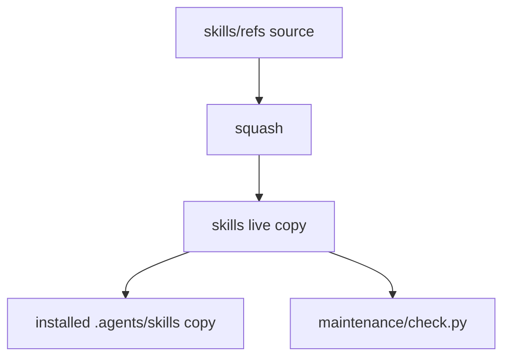

# Skills

Each reusable AI skill is a self-contained directory with a `SKILL.md` entry point and supporting files loaded on demand.

| Skill | Purpose |
| --- | --- |
| [arena-skill](arena-skill/SKILL.md) | Steer Arena agents through the shared preview inbox. Publish rendered reports and read privileged data beyond the sandbox through the owner-run proxy backend. |
| [nuu](nuu/SKILL.md) | Build and revise web pages in a settled house style, from the typed sheet and the annotated examples to the measured result |
| [nemoizer](nemoizer/SKILL.md) | Replace AI-flavored synonyms with the plain word, from one rotation table and a bundled linter with reviewable ignore markers |
| [squash](squash/SKILL.md) | Compress text to token, word, character, or byte budgets without losing meaning |

## Format

Every skill must follow the [Agent Skills specification](https://agentskills.io/specification). Check each added or edited skill.

- `SKILL.md` is the entry point. It holds YAML frontmatter and Markdown instructions.
- Required `name`: 1 to 64 lowercase letters, digits, or single internal hyphens, matching the directory name.
- Required `description`: 1 to 1024 characters stating the action and when to use it. Agents select skills from name and description alone.
- Optional fields: `license`, `compatibility`, `metadata`, and `allowed-tools` (`license` is required with `metadata.upstream`). Put any other keys, such as `argument-hint`, under `metadata` as strings.
- The optional directories are `scripts/`, `references/`, and `assets/`.
- Keep `SKILL.md` below 500 lines. Move the detail into `references/`, which the agent loads only when necessary.
- A skill carries only what an agent needs to use it. Leave background, rationale, and history to the changelog.

`skills/refs/<skill>/` holds full uncompressed baseline trees for skills that have baselines. See [maintenance/README.md](../maintenance/README.md) for source/live synchronization.

## Upstream sources

Adapted skills record `metadata.upstream`. Update from that source, then reapply local `Precedence`: explicit user requirements and project conventions outrank skill preferences. Visual-reference structure and image-board examples in `nuu` are adapted from [UI Prep, The Best Way to Document UX/UI Design](https://www.uiprep.com/blog/the-best-way-to-document-ux-ui-design).

## Install

Humans install, update, and remove skills. Agents may inspect installed copies but must treat them as read-only. Report missing or incompatible files, never install or repair them. Source-edit requests here do not authorize installed-copy changes.

Copy whole skill folders into a supported discovery path. Keep their names, `scripts/`, `references/`, and `assets/`. `SKILL.md` alone is insufficient.

With an agent that finds project skills under `.agents/skills/`, run:

```bash
mkdir -p .agents/skills
cp -R /path/to/clankers/skills/squash .agents/skills/
```

### Discovery notes

Check each path and its precedence against your installed release.

| Agent | Project | Global |
| --- | --- | --- |
| Antigravity for VS Code | `.agents/skills/` or legacy `.agent/skills/` | `~/.gemini/config/skills/` |
| Cline | `.cline/skills/` | `~/.cline/skills/` |
| Kilo Code | `.kilo/skills/` or `.agents/skills/` | `~/.kilo/skills/` |

The Antigravity row covers VS Code, not the CLI. Keep one active copy unless you first check precedence. Reload or restart discovery as necessary. Do not embed shell-execution syntax: permissions differ by scope.

After setup, ask the agent to name an installed `SKILL.md` and its conditional reference paths without reading all supporting files. Report missing skills, never install or silently ignore them. Supply skills explicitly without automatic discovery.

### Skill selection

| Skill | When needed |
| --- | --- |
| [arena-skill](arena-skill/SKILL.md) | Arena sessions needing mid-turn messages or rendered reports, and reads of a source the sandbox cannot reach |
| [squash](squash/SKILL.md) | Text that must fit one or more token, word, character, or byte budgets |

Skills stand alone, independent of the rule files in [rules/](../rules/).

## Maintenance



See [maintenance/README.md](../maintenance/README.md) for skill synchronization, validation, and generated-copy maintenance.
