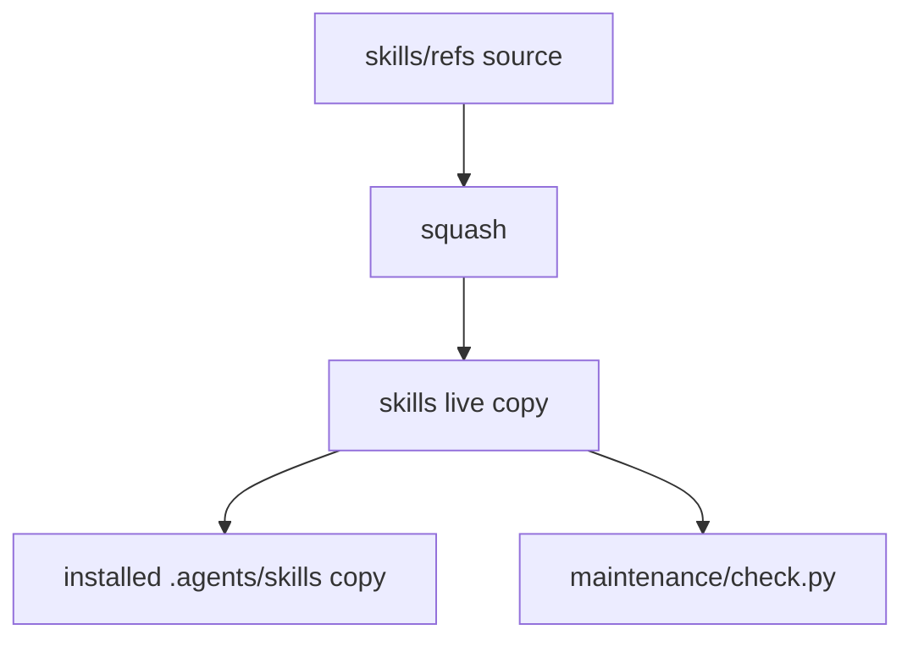

# Skills

Each reusable AI skill is a self-contained directory with a `SKILL.md` entry point and supporting files loaded on demand.

| Skill | Purpose |
| --- | --- |
| [arena-steering](arena-steering/SKILL.md) | Steer Arena agents through the modular `steer` CLI, dependency task queue, and fielded Markdown reports. |
| [nuu](nuu/SKILL.md) | Build and revise web pages in a settled house style, from the typed sheet and the annotated examples to the measured result |
| [nemoizer](nemoizer/SKILL.md) | Replace AI-flavored synonyms with the plain word, from one rotation table and a bundled linter with reviewable ignore markers |
| [squash](squash/SKILL.md) | Compress text to token, word, character, or byte budgets without losing meaning |

## Format

Skills in this repo follow the [Agent Skills specification](https://agentskills.io/specification), and `maintenance/check.py` validates them.

- `SKILL.md` is the entry point and holds YAML frontmatter plus Markdown instructions.
- `name` uses 1 to 64 lowercase letters, digits, or single internal hyphens and matches the directory name.
- `description` uses 1 to 1,024 characters to state what the skill does and when an agent selects it.
- Optional frontmatter keys are `license`, `compatibility`, `metadata`, and `allowed-tools` (`license` is required when `metadata.upstream` is set, and custom keys live under `metadata` as strings).
- Optional subdirectories are `scripts/`, `references/`, and `assets/`.
- `SKILL.md` stays under 500 lines, with detailed material loaded on demand from `references/`.
- Skill payloads hold only agent instructions, while human overviews and history live under `docs/<skill>/`.

`skills/refs/<skill>/` holds uncompressed baseline trees for skills with baselines. See [maintenance/README.md](../maintenance/README.md) for baseline and live sync.

## Upstream sources

Adapted skills record `metadata.upstream` and reapply a local `Precedence` section so user instructions and project conventions outrank skill defaults. Visual-reference structure and image-board examples in `nuu` are adapted from [UI Prep, The Best Way to Document UX/UI Design](https://www.uiprep.com/blog/the-best-way-to-document-ux-ui-design).

## Install

Skill installation and updates are human maintenance steps, and agents treat installed copies as read-only. Copy the full skill directory, including `scripts/`, `references/`, and `assets/`, into a supported discovery path (`SKILL.md` alone is incomplete).

For an agent that discovers project skills under `.agents/skills/`, run in Windows cmd:

```cmd
mkdir .agents\skills
xcopy /E /I C:\path\to\clankers\skills\squash .agents\skills\squash
```

Or in Bash:

```bash
mkdir -p .agents/skills
cp -R /path/to/clankers/skills/squash .agents/skills/
```

### Discovery notes

Check discovery paths and precedence against your installed agent version.

| Agent | Project | Global |
| --- | --- | --- |
| Antigravity for VS Code | `.agents/skills/` or legacy `.agent/skills/` | `~/.gemini/config/skills/` |
| Cline | `.cline/skills/` | `~/.cline/skills/` |
| Kilo Code | `.kilo/skills/` or `.agents/skills/` | `~/.kilo/skills/` |

The Antigravity row covers the VS Code extension rather than the CLI. Keeping one active copy avoids precedence ambiguity, and some hosts require a reload after copying files. To verify installation, ask the agent to list the installed `SKILL.md` and its `references/` paths without loading every file.

### Skill selection

| Skill | When needed |
| --- | --- |
| [arena-steering](arena-steering/SKILL.md) | Arena sessions needing mid-turn messages, dependency tasks, or rendered fielded reports |
| [squash](squash/SKILL.md) | Text that must fit one or more token, word, character, or byte budgets |

Skills stand alone, independent of the rule files in [rules/](../rules/).

## Maintenance



See [maintenance/README.md](../maintenance/README.md) for skill synchronization, validation, and generated-copy maintenance.
