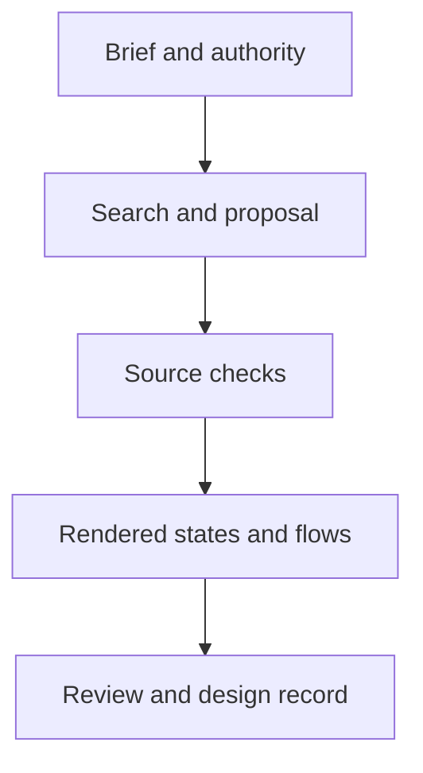

# Nemo UI/UX

Build, refine, and review web interfaces. Tools cover briefs, local catalogs, design records, assets, source checks, rendered evidence, and task flows. Existing product systems take precedence over the optional house profile.

## Setup

Load [SKILL.md](SKILL.md) in an agent that supports skills. See [Skills](../README.md) for installation layout. Local tools need Python 3.10+ and its standard library. Browser tools also need Node, the floating `playwright` package, and an available browser.

The project supplies its page, running application, and browser. Tools capture pages but install no package or browser.

## Working flow

1. Read the project's design record, or start from [the template](references/design-document.md).
2. Preserve the product system, or select the house [sheet](references/style.css) and [examples](references/examples.md).
3. Change the page and inspect the rendered states at 1280 and 360 pixels.
4. Collect computed values with [the browser snippet](references/measure.md), check them, and retain the reports and screenshots.
5. Update the project design record with settled decisions and evidence.

The skill holds the complete house constraints. The record and screenshots describe the consuming project, not this skill's source files.

## Available tools

From the repository root in Windows cmd:

```cmd
python skills\nemo-ui-ux\scripts\measure.py check report.json
python skills\nemo-ui-ux\scripts\measure.py ruler --from 120,340 --to 264,340
```

`check` reads one JSON report of computed CSS values. `ruler` measures horizontal, vertical, and straight-line distances between two page coordinates.

`check` uses sheet rules. `ruler` uses only the scale. Exit status is 0 for a pass and 1 for findings.

Defaults: the bundled sheet and an 8-pixel scale.

Global options precede the command:

```cmd
python skills\nemo-ui-ux\scripts\measure.py --scale 4 --sheet path\to\style.css check report.json
```

A report has this shape:

```json
{
  "width": 1280,
  "elements": [
    {"selector": ".row", "values": {"height": "40px", "gap": "16px"}}
  ]
}
```

## Full workflow tools

From the repository root in Windows cmd:

```cmd
set UI=skills\nemo-ui-ux\scripts\uiux.py
python %UI% doctor
python %UI% brief --task "Review the request form" --output brief.json
python %UI% search "dashboard accessibility" --dataset ux-guidelines
python %UI% system --brief brief.json --output system-proposal.json
python %UI% teach --record docs/design.md
python %UI% lint --project path\to\product
python %UI% inspect --url https://example.com --artifacts evidence --output inspect.json
python %UI% flow --url https://example.com --flow flow.json
python %UI% audit --project path\to\product --url https://example.com
python %UI% polish --project path\to\product --evidence inspect.json
```



[Tool contracts](references/tools.md) describe assets, live edits, eight review modes, inputs, exit codes, and missing coverage. Review modes supply evidence and task-specific checks. Visual judgment and repairs remain agent work. Search uses licensed local CSV data with source hashes, not external page content.

Read-only tools keep product files unchanged. Record creation, asset fetches, and transient live edits need their explicit command flags. Existing output files and design records are not overwritten.

## Limits

`measure.py` checks supplied pixel values. `uiux.py` adds local tools and optional browser evidence. Source checks cover selected HTML and CSS patterns. Script markup remains unverified until rendered.

Missing elements and non-pixel values do not become complete coverage checks. A passing report does not prove accessibility, usability, behavior, or visual quality. Those need rendered and interaction review.

This README is human documentation and is not part of the installed skill payload. The source credits follow.

## Sources

### Repositories

| Source | Commit | License |
| --- | --- | --- |
| [UI/UX Pro Max](https://github.com/nextlevelbuilder/ui-ux-pro-max-skill/tree/56ea9cf174ed86786187daa9de0e6247cb0747e4) | `56ea9cf` | MIT |
| [Anthropic frontend-design](https://github.com/anthropics/skills/tree/dbd4588f9e1033efb41dad4bef2f7947c8993d44/skills/frontend-design) | `dbd4588` | Apache 2.0 |
| [Taste skill](https://github.com/Leonxlnx/taste-skill/tree/6010f91a9935f1c167dfc500fb1a475681892e6b) | `6010f91` | MIT |
| [Vercel Web Interface Guidelines](https://github.com/vercel-labs/web-interface-guidelines/tree/434b7f91364665f2f733b310ec54809bf8f37937) | `434b7f9` | MIT |
| [Impeccable](https://github.com/pbakaus/impeccable/tree/dad8dbb3aac21ad1fa236c110315ef4abece23e8) | `dad8dbb` | Apache 2.0 |

### Websites — fetched 2026-10-21

- [Jakob Nielsen: 10 Usability Heuristics](https://www.nngroup.com/articles/ten-usability-heuristics/)
- [NN/g: Good Visual Design, Explained](https://www.nngroup.com/articles/good-visual-design/)
- [GOV.UK: Design Manual](https://www.gov.uk/service-manual/design)
- [GOV.UK: Using, adapting and creating patterns](https://www.gov.uk/service-manual/design/using-adapting-and-creating-patterns)
- [W3C: WCAG 2.2 Quick Reference](https://www.w3.org/WAI/WCAG22/quickref/)
- [Atlassian Design System](https://atlassian.design/)
- [Atlassian: Design tokens](https://atlassian.design/foundations/tokens)
- [NN/g: Usability Testing 101](https://www.nngroup.com/articles/usability-testing-101/)
- [Pencil & Paper: UX Design Documentation Guide](https://www.pencilandpaper.io/articles/ux-design-documentation-guide)
- [Figma: Guide to Developer Handoff](https://www.figma.com/best-practices/guide-to-developer-handoff/)
- [Figma: Components, Styles, and Shared Libraries](https://www.figma.com/best-practices/components-styles-and-shared-libraries/)
