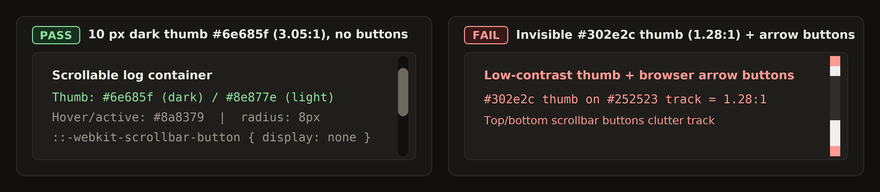

# Recipe: Scrollbars

Style scrollbars with a thin `10px` rounded thumb (`#6e685f` in dark mode at `>= 3:1` contrast, `#8e877e` in light mode, and `#8a8379` on hover/active) on the surface track (`var(--bg)`), `8px` radius, and no arrow buttons (`::-webkit-scrollbar-button { display: none; }`). Scope `scrollbar-width: thin` and `scrollbar-color` inside `@supports not selector(::-webkit-scrollbar)` so Chromium keeps the rounded WebKit thumb and hidden buttons while Firefox receives a matching thin track and thumb.



```css
:root {
  --scrollbar-thumb: #8e877e;
  --scrollbar-thumb-hover: #8a8379;
}

@media (prefers-color-scheme: dark) {
  :root {
    --scrollbar-thumb: #6e685f;
    --scrollbar-thumb-hover: #8a8379;
  }
}

:root[data-theme="light"] {
  --scrollbar-thumb: #8e877e;
  --scrollbar-thumb-hover: #8a8379;
}

:root[data-theme="dark"] {
  --scrollbar-thumb: #6e685f;
  --scrollbar-thumb-hover: #8a8379;
}

::-webkit-scrollbar {
  width: 10px;
  height: 10px;
}

::-webkit-scrollbar-track,
::-webkit-scrollbar-corner {
  background: var(--bg);
}

::-webkit-scrollbar-thumb {
  background: var(--scrollbar-thumb);
  border-radius: 8px;
}

::-webkit-scrollbar-thumb:hover,
::-webkit-scrollbar-thumb:active {
  background: var(--scrollbar-thumb-hover);
}

::-webkit-scrollbar-button {
  display: none;
  width: 0;
  height: 0;
}

@supports not selector(::-webkit-scrollbar) {
  * {
    scrollbar-width: thin;
    scrollbar-color: var(--scrollbar-thumb) var(--bg);
  }
}
```
