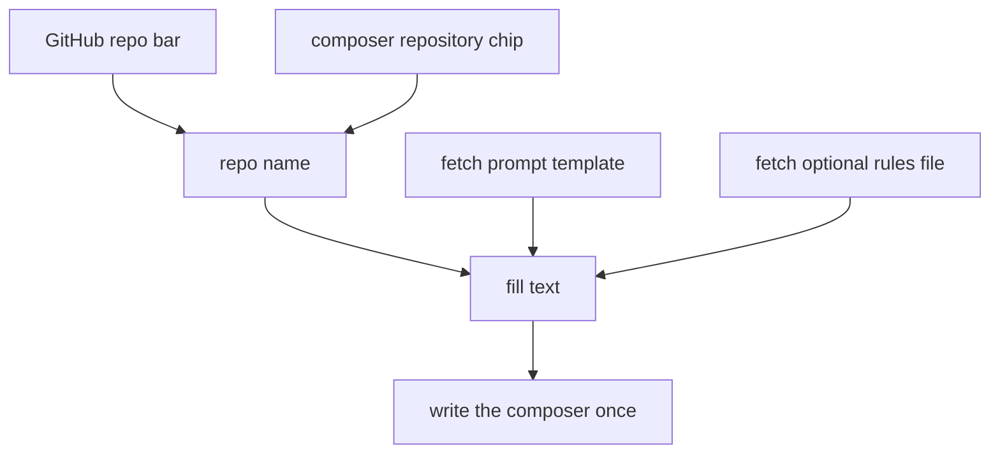

# Userscripts

Tampermonkey userscripts for Arena.ai and chatgpt.com.

| Bundle | Features |
| --- | --- |
| [arena.user.js](arena.user.js) | Prompt fill, Open Steering, Hide composer, Auto-send wake up, Keep working, Transcript auto-scroll, Transcript trim, Preview state download, Tab title, Keep awake |
| [chatgpt.user.js](chatgpt.user.js) | Hide elements, Auto Think |

## Install

1. Install Tampermonkey in the browser.
2. Open its dashboard and create a new script.
3. Paste one bundle's `.user.js` contents and save.
4. Repeat for the other domain if needed.

To migrate, disable or remove the five old scripts before enabling the bundles. Reload open Arena and ChatGPT tabs to stop old timers and observers. Old installations do not become bundles automatically.

Each bundle has its own version and raw GitHub update URL. A saved feature setting belongs to its bundle.

The baseline is `refs/arena-prompt-fill.txt`. The served `arena-prompt-fill.txt` uses meaning-preserving compression with an `o200k_base` token budget.

## Feature switches

Twelve switches default to On. Auto trim ships OFF because it removes transcript content from the page. On a matching page, open the Tampermonkey menu and select a command such as `Composer - fill (ON)`. The ChatGPT bundle keeps its own `Auto Think: ON - toggle` shape.

Every Arena entry leads with its module, and a switch shows its saved setting in parentheses. One module's entries stay together. The modules sit in one order:

1. Composer
2. Proxy
3. Steering
4. Transcript
5. State
6. Page
7. Userscript

Switches apply immediately in the current tab. Other open tabs use saved settings on their next reload. Disabling stops the feature's observers, timers, and listeners.

The bundles use `GM_getValue` and `GM_setValue` for saved settings, plus menu registration and removal, and they hold no check code. Switches never reload the page. Disabling a hiding feature restores its own DOM changes where the page has not replaced them. Earlier automatic clicks and inserted prompt text remain.

## Console log

Arena uses `[NemoUtils][module][level] event` with allowlisted fields. Default `info` includes warnings and errors. `Userscript - log level` cycles `info`, `debug`, `warn`, and `error`, saves the setting, and applies it immediately.

Only debug mode includes repository names and filenames. Keys, message text, page labels, URLs, and raw error text stay out. The logger does not suppress repeated events, save records, or send records.

Title logs require a title or emoji change. Debug adds decision conditions for that change. ChatGPT keeps its existing `[NemoUtils]` output.

## Arena prompt fill

The feature fills the composer on `/agent` and on `/agent/`, not on paths with a trailing segment.

The bar serves a session. On a new chat the composer's own repository chip names the repository. If neither component renders, the tab title provides the repository name.

A selected diff branch wears the same owner/repo shape as the repository chip. The read skips a platform session branch, written `arena/<id>-<repo>`, and takes the repository beside it.

The fill fetches `userscripts/arena-prompt-fill.txt` once from this repository. It waits for that text before writing, and leaves the composer unchanged if the fetch fails. The fill optionally fetches `rules/ARENA.md` and appends it when that fetch succeeds.

The template requests strong reasoning and context retention for a potentially long, complex task, not model selection. It says work can continue indefinitely, and each final poll waits up to 1,800 seconds or until skipped.



The message then carries a six-step checklist:

1. Read the task, grep every caller of the code it touches, and trace the flow end to end.
2. Name the requirements and the constraints, and follow the conventions in the code.
3. Take the smallest change that holds: reuse first, one line second, new code last, and add nothing the task does not ask for.
4. Write the failing check before new or changed executable behavior, and reproduce a bug before the fix.
5. Keep the behavior, interfaces, validation, and security that stand.
6. Run the project's own gate, and read the result before the report.

Six rules follow the checklist:

- Red first for new executable behavior. Prose uses existing lint and structural checks, with exact-text tests only for executable interface or protocol contracts.
- A root-cause fix for a bug, with no repeated failed approach.
- Stated assumptions.
- No claim of an unrun check.
- Screenshots and corrections through the steering channel, with each image read directly.
- A closing report of the change, the checks and the open items.

## Arena auto-send wake up

`Composer - auto-send wake up` defaults to On. On Arena composer and session pages, it clicks Send message after a random 0-5 second delay. The whole composer text must equal `wake up`. Case changes, whitespace, and other text do not match.

The feature checks the draft and controls again before the click. A hidden composer, disabled control, security check, IME composition, or global pause prevents the click. Disabling cancels the timer and listeners. An unchanged draft triggers at most one click in the current page runtime.

The same switch fills an empty composer when the latest message root contains a matching generation-error banner. Banner visibility does not matter. Other drafts stay unchanged. Each root ID permits one automatic fill in the current page runtime, including after a DOM remount.

Auto-wake logs `filled` after an error-recovery insert and `clicked` after the Send button click. These events contain no message text and do not prove server acceptance.

`Composer - keep working` defaults to On. It checks whether the latest message root ends on a non-spinner, non-`prose` row while `Keep working` is visible. It then clicks `Keep working`, waits for an enabled empty composer, enters `wake up`, and logs `clicked` and `filled` once per root.

## Arena transcript trim

This switch ships OFF, and OFF stops the trim: a reload redraws the transcript from Arena, so removed rows return. On `/agent/*`, ON keeps the newest `50` row nodes across all message roots and removes older rows first. The row limit cannot fall below `20`.

The trim removes a message's sibling action container only when that pass removes rows and leaves no live row. It keeps each message root because Arena crashes if a `#chat-message-*` root leaves its tree.

The independent `Transcript - hide generation alerts` switch defaults to On. It hides red alerts with `role="alert"`, `border-red-500/30`, and `bg-red-500/10` while Stop generating is present, regardless of alert text. Auto trim does not control it. On generation stop, switch disable, or global pause, it restores only its own `display` changes.

The menu command reads `Transcript - keep 50 rows`. After a trim it adds the running row count, such as `Transcript - keep 50 rows (12 removed)`. A trim that removes rows also writes one console line.

The command takes one row limit:

- it converts a saved two-value plan to its row limit
- an empty or too small answer keeps the old plan

## Arena security check hold

While the Arena security check shows, the tab title carries the shield emoji and the automatic posts wait. The held work is the prompt fill, the Open Steering click, the auto-wake click, and the proxy key posts. Each tab reads its own page. The held work resumes when the check clears.

## Arena userscript pause

One entry, `Userscript - pause all`, stops every feature where it stands: the observers, the timers, the automatic posts and the tab title. The press applies at once, with no reload, and the entry then reads `Userscript - resume all`. The resume brings back every feature whose own switch is ON and leaves the others off.

The script saves the pause, so a reload keeps it. Each feature switch stays in the menu while paused.

## Arena state saves

The userscript fetches a candidate from `GET /api/userscript-autosave`. It compares the server's two retained completion stamps with the browser's last successful receipt. After the pair matches, it uses the digest to skip an unchanged candidate.

A stamp-pair mismatch stops automatic replacement. A changed digest writes the candidate.

A new empty selected file can receive its first save. `State - force save` keeps the explicit override. Its successful completion receipt sets the pair that later automatic saves use.

Only a successful file close or download-manager callback permits the completion receipt, sent to `POST /api/userscript-autosave`. Failed receipts retry without another file write. Browser-link downloads have no completion callback and do not advance the saved baseline.

Failed saves keep their notices. A successful file close or download-manager callback clears persistent notices. Temporary success messages keep their timeout.

The preview retains two saved core states with completion receipts per repository and branch. New save files include flat, versioned history. Manual Copy state stays core-only.

Replacement imports check and restore supplied history. Legacy imports preserve it. Merge imports preserve existing history or adopt supplied history only when none exists.

The existing minute timer defers each periodic request by a random 0-15 seconds. These autosave routes add no authentication or token check.

## Arena state reset window

The `State - reset-window overwrite` switch ships On.

A preview URL change skips the overwrite prompt within 150 seconds of 02:00, 08:00, 14:00, or 20:00 PHT. The saved-state comparison must permit the write. A branch change, a missing branch, and every hour outside that window keep the prompt.

## Arena tab title

On `/agent/*`, ON reads the repository name from the GitHub link in the session header and sets the tab title to `Arena | <repository>`. If the link is absent, it reads a valid repository name before ` read ` in the session title button. State-file naming uses the same fallback before a stale tab title.

While the agent works, the title reads the newest row of the last message root. It finds the body after a message header and keeps the previous lookup as a fallback.

The row type selects the mark, and an action row's status label names its emoji, such as `Arena | clankers 🖥️`. A running row answers with its shimmer, and a buttonless row read takes its `body-sm` span, with a fetch URL's anchor text dropped.

| Mark | Source |
| --- | --- |
| 🖥️ | running, including `Bash` and `command` |
| 📖 | read: `Read` and `Explored` |
| ✏️ | edit: `Edit`, `Editing`, `Editing files`, `Write` and `Writing` |
| 🔍 | search and fetch |
| 💭 | the reasoning row, the `not-prose` block |
| 💤 | wait, and a row whose command runs the preview poll |
| 💬 | the newest chat message, the `prose` body |
| ❓ | an `ask_user` question card, or an action row generating questions |
| 🛡️ | the security check |
| ⏳ | the model at work with no row mark |
| ⚙️ | anything else |

A finished row keeps its shimmer or its pulse in the page, so a row counts only while the stop-generating control is up. That control bounds the read: the last root, its newest row, the waiting line and the process card.

A process card carries a play icon and the process name, so it takes 🖥️ as the newest message of a live turn.

## ChatGPT hide elements

On any `chatgpt.com` path, the feature adds `hidden` to twelve managed targets:

- The div that holds the Claim offer button.
- The div that holds the Free offer button.
- The Chat and Work header toggle.
- The Codex sidebar entry.
- The Images sidebar entry.
- The Library sidebar entries, in the collapsed rail and in the open nav list.
- The Free badge.
- The prompt textarea header banner.
- The header Upgrade and Share controls.
- The sidebar Upgrade control.
- The Upgrade to Plus row, without hiding adjacent actions.

Each target has a saved, default-on menu switch. The Hide elements switch controls all targets without changing their saved preferences or Auto Think. One MutationObserver repeats the work when the page changes, and turning hiding off restores only nodes the script hid.

## ChatGPT auto think

On any `chatgpt.com` path, the feature clicks the Think pill every second while `aria-pressed` is `false`.

## Check

From the repository root:

```bash
node userscripts/arena.user.js
node userscripts/chatgpt.user.js
node --test maintenance/workflows/userscripts.checks.cjs
node --test maintenance/workflows/userscripts.test.cjs
```

Each command prints `ok` when its checks pass. The bundles carry runtime code only: outside a browser each feature publishes its helpers through `exposeChecks`, and the feature checks run from `maintenance/workflows/userscripts.checks.cjs`. The integration check covers saved switches, reloads, disabled startup, storage errors, transcript growth, forced follow, live cleanup and navigation.
